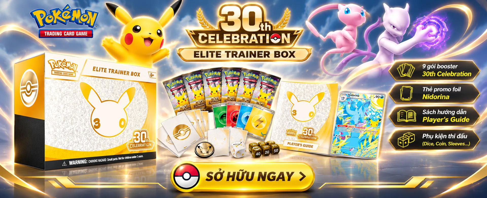
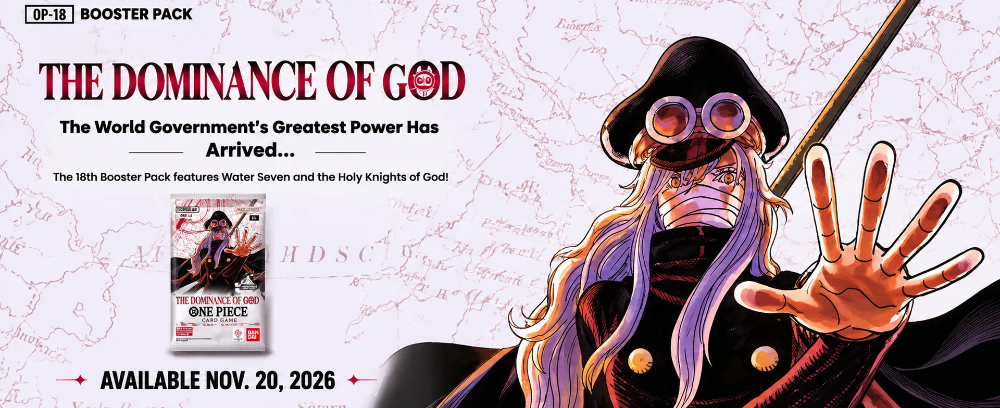
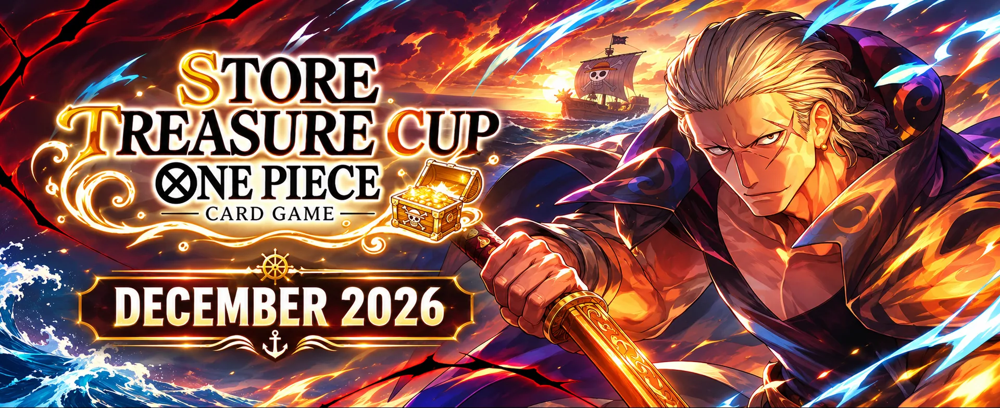

  

<h3 align="center">HUNT · TRADE · COLLECT</h3>

Cửa hàng thẻ bài sưu tầm chính hãng dành cho người chơi và nhà sưu tầm TCG.

  

## Dark Poke là ai

Dark Poke là cửa hàng thẻ bài sưu tầm (Trading Card Game), tập trung vào Pokémon TCG và One Piece Card Game. Chúng tôi bán sản phẩm chính hãng: từ hộp nguyên seal tới từng lá bài lẻ, cùng một không gian để cộng đồng săn thẻ, trao đổi và hoàn thiện bộ sưu tập của mình.

Khẩu hiệu **Hunt · Trade · Collect** nói lên ba việc người chơi làm mỗi ngày, và Dark Poke có mặt ở cả ba:

- **Hunt:** săn hộp mới, booster, thẻ hiếm và thẻ grading.
- **Trade:** mang thẻ tới bán lại hoặc đổi lấy sản phẩm mới.
- **Collect:** tra cứu, định giá và giữ bộ sưu tập ở tình trạng tốt nhất.

## Sản phẩm

| Nhóm | Gồm |
| --- | --- |
| **Sealed** | Booster Box, Elite Trainer Box, booster pack, tin, bộ quà tặng nguyên seal |
| **Thẻ lẻ** | Lá bài lẻ theo bộ, độ hiếm và tình trạng thẻ |
| **Grading** | Thẻ đã chấm điểm bởi PSA, CGC, BGS |
| **Phụ kiện** | Sleeve, binder, deck box, top loader, playmat |
| **Pre-order** | Đặt trước bộ mới ra mắt, giữ suất bằng tiền cọc |

  

## Dịch vụ

- **Đặt trước (pre-order):** giữ hàng bộ mới ngay từ khi công bố, nhận hàng đúng ngày phát hành.
- **Thu mua và đổi thẻ:** gửi ảnh thẻ, nhận báo giá, bán lại hoặc đổi lấy sản phẩm tại cửa hàng.
- **Thư viện thẻ:** tra cứu hình ảnh, thông tin từng lá bài và giá thị trường tham khảo (TCGplayer, Cardmarket) quy đổi sang VND.
- **Mua sắm trực tuyến:** đăng nhập bằng Google, thanh toán chuyển khoản qua mã QR, theo dõi đơn hàng ngay trên web.
- **Mua tại cửa hàng:** xem hàng trực tiếp và thanh toán tại quầy.

## Cam kết

- 100% sản phẩm chính hãng, rõ nguồn gốc.
- Tình trạng thẻ lẻ được mô tả rõ ràng trước khi bán.
- Đóng gói cẩn thận, bảo vệ hộp và thẻ trong suốt quá trình giao hàng.
- Giá thu mua minh bạch, tham khảo theo giá thị trường.

  

## Cộng đồng

Dark Poke đồng hành cùng các giải đấu và sự kiện tại cửa hàng, như **One Piece Card Game Store Treasure Cup** tháng 12/2026. Theo dõi trang chủ để cập nhật bộ mới, lịch pre-order và sự kiện sắp tới.

---

<b>Dark Poke</b> · Hunt · Trade · Collect

